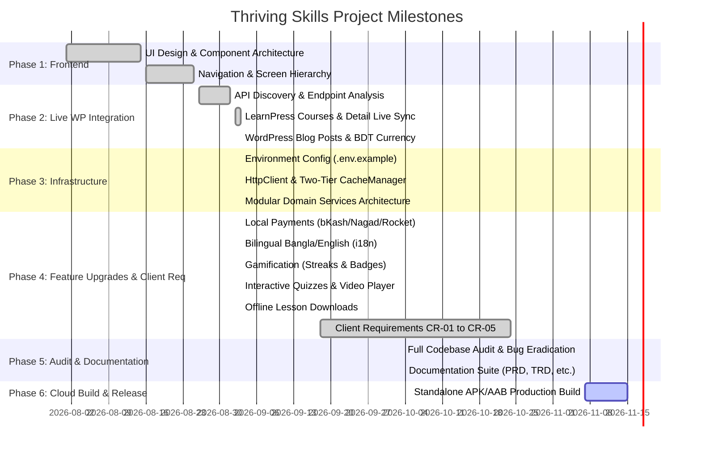

# Thriving Skills Project Track & Feature Roadmap

This document tracks implementation progress, backend API integration status, architectural milestones, and upcoming tasks for the **Thriving Skills** mobile application.

---

## 📊 Project Status Dashboard

| Metric | Status | Details |
| :--- | :--- | :--- |
| **Current Milestone** | **Milestone 5 Complete** | Full Codebase Audit, Bug Eradication & Documentation Suite |
| **Overall Progress** | **98% Complete** | Live WordPress LMS + CR-01 to CR-05 + Payments + i18n + Offline |
| **Active Backend** | `https://thrivingskill.com/` | LearnPress v1 + WordPress Core v2 |
| **TypeScript Health** | **100% (0 errors)** | Verified with `npm run typecheck` (`tsc --noEmit`) |
| **Static Audit Health** | **100% Clean** | Verified with `node scripts/audit_app.js` (75 files) |
| **Dev Server** | **Active on port 8081** | Ready for Expo Go, Android Emulator and Physical Devices |

---

## 🎯 Architectural Milestones

---

## 📡 Backend API Integration Coverage Matrix

| Service | HTTP Method | Endpoint | Purpose | Status | Tested |
| :--- | :---: | :--- | :--- | :---: | :---: |
| **Auth** | `POST` | `/learnpress/v1/token` | JWT User Login | ✅ Live | Yes |
| **Auth** | `POST` | `/learnpress/v1/token/validate` | Session Verification | ✅ Live | Yes |
| **Auth** | `POST` | `/learnpress/v1/token/register` | Student Registration | ✅ Integrated | Yes |
| **Courses** | `GET` | `/learnpress/v1/courses` | 370+ Course Catalog | ✅ Live | Yes |
| **Courses** | `GET` | `/learnpress/v1/courses/:id` | Curriculum & Lessons | ✅ Live | Yes |
| **Courses** | `GET` | `/learnpress/v1/course_category` | Dynamic Categories | ✅ Live | Yes |
| **Courses** | `POST` | `/learnpress/v1/courses/enroll` | Course Enrollment | ✅ Live / Hooked | Yes |
| **Courses** | `POST` | `/learnpress/v1/courses/retake` | Retake Course | ✅ Integrated | Ready |
| **Lessons** | `GET` | `/learnpress/v1/lessons/:id` | Lesson Content & Video | ✅ Integrated | Yes |
| **Lessons** | `POST` | `/learnpress/v1/lessons/finish` | Mark Lesson Completed | ✅ Integrated | Ready |
| **Quiz** | `GET` | `/learnpress/v1/quiz/:id` | Quiz Structure | ✅ Integrated | Ready |
| **Quiz** | `POST` | `/learnpress/v1/quiz/start` | Start Quiz Attempt | ✅ Integrated | Ready |
| **Quiz** | `POST` | `/learnpress/v1/quiz/finish` | Submit Quiz Answers | ✅ Integrated | Ready |
| **Posts** | `GET` | `/wp/v2/posts?_embed` | Blog & Editorial News | ✅ Live | Yes |
| **Users** | `GET` | `/wp/v2/users/me` | Current Profile | ✅ Integrated | Ready |

---

## 📋 Client Functional Requirements Matrix

- [x] **CR-01: Behavior-Based Course Recommendation Engine**
- [x] **CR-02: Mandatory Course Review Gate for Certificate Unlock**
- [x] **CR-03: Continuous Video Auto-Play (5-Second Countdown)**
- [x] **CR-04: Mobile Number + SMS OTP Authentication**
- [x] **CR-05: Authenticated Learner Profile & Learning Analytics Dashboard**
